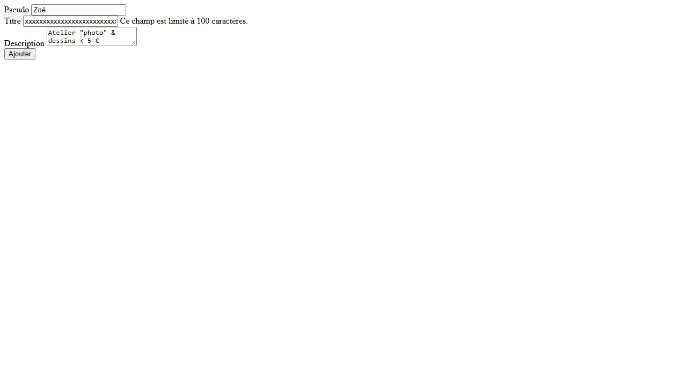

# US 4 — Valider une idée avant de l’enregistrer

**24 novembre 2026 · IdeaBox · Codex (GPT-6)**

L’utilisateur a demandé « Ok nickel, bah écoute, est-ce que tu peux me faire aussi l'US 4 s'il te plaît ? »

## Origine du code

Codex a écrit le traitement et effectué une relecture. Le backlog prévoit une première version écrite par l’étudiant puis relue par l’IA. Cette note décrit la réalisation effective et les tests exécutés par Codex.

## Fonctionnement

`includes/validation-idee.php` définit les limites à partir de `sql/schema.sql`. Le titre accepte 100 caractères et le pseudo 50. Pour la description, la colonne MySQL `TEXT` accepte 65 535 octets. Une lettre accentuée ou un emoji peut occuper plusieurs octets.

`enregistrer-idee.php` vérifie les trois champs en PHP avant toute insertion. Le traitement conserve le texte original pour réafficher la saisie. Il retire les espaces de début et de fin avec `trim()` sur la copie destinée au contrôle et à l’enregistrement.

En cas d’erreur, `index.php` affiche le formulaire rempli et un message associé à chaque champ à corriger. La réponse HTTP 422 appartient à l’onglet qui a envoyé le formulaire. La correction reprend le parcours de l’US 3 avec une insertion, une redirection vers les cartes et un message de confirmation.

## Remarques de relecture et décisions

| Remarque | Décision et raison |
| --- | --- |
| Le navigateur peut limiter la frappe, mais une requête peut tout de même contenir des valeurs trop longues. | Le serveur applique ses propres limites à chaque envoi. Les champs absents et les valeurs qui ne sont pas du texte sont refusés. |
| La description, le titre et le pseudo n’ont pas la même unité de stockage. | La validation compte les caractères UTF-8 du titre et du pseudo. Pour la description, elle compte les octets. Aucune limite arbitraire de 500 caractères n’a été ajoutée. |
| Un champ visuellement vide peut contenir des espaces insécables. | Le contrôle reconnaît aussi les champs constitués uniquement d’espaces Unicode. |
| Réafficher une valeur avec des guillemets ou des chevrons peut en modifier le rendu. | Les valeurs sont échappées pour l’affichage HTML. La description dispose d’une zone multiligne pour restituer les paragraphes. |
| La première version relisait les cartes même quand l’envoi était invalide. Une panne de base empêchait alors de revoir la saisie. | Corrigée. La réponse d’erreur affiche uniquement le formulaire, sans accès à la base. La liste des cartes est chargée après un envoi réussi ou lors d’une visite normale. |

## Vérifications réalisées

Le parcours a été testé dans Chrome 158 avec PHP 8.4.27 et une base MariaDB 11.4.8 temporaire contenant déjà une idée fictive. Les requêtes ont été exécutées sur une copie du projet, avec le schéma SQL de l’équipe.

| Essai | Résultat observé |
| --- | --- |
| Titre vide, composé d’espaces ordinaires ou d’espaces Unicode | Refus dans les trois cas. Le message apparaît à côté du titre. Aucune idée ajoutée. |
| Pseudo absent, pseudo reçu sous forme de tableau ou trois champs incorrects à la fois | Le formulaire signale chaque champ concerné. Aucune insertion. |
| Titre de 101 caractères, pseudo de 51 caractères accentués ou description de 65 536 octets | Réponse HTTP 422 à chaque envoi. Les autres valeurs restent disponibles. |
| Titre de 100 caractères Unicode, pseudo de 50 et description de 65 535 octets | Insertion réussie. Les valeurs ont été relues en SQL. |
| Retirer `maxlength` dans le formulaire chargé par Chrome et cliquer sur « Ajouter » avec 101 caractères | Le serveur refuse. Chrome affiche le message à côté du titre et les trois valeurs restent modifiables. |
| Corriger uniquement le titre et soumettre le même formulaire | L’idée apparaît dans la liste avec le pseudo et la description d’origine, et zéro vote. Actualiser la page ne crée aucun doublon. |
| Réafficher des guillemets, un chevron ou une description qui commence par une ligne vide | Le navigateur restitue le texte saisi, y compris le premier retour à la ligne de la description. |
| Envoyer un titre composé d’espaces après l’arrêt de la base | Le serveur renvoie toujours le formulaire avec le message sur le titre et les deux autres valeurs. |

## Revue complémentaire de sécurité

Le test avec deux sessions distinctes vérifie qui peut voir une saisie refusée. Les observations sur le formulaire, le cache et les journaux figurent dans le [bilan de sécurité des US 3 et 4](US03-US04-securite.md).
